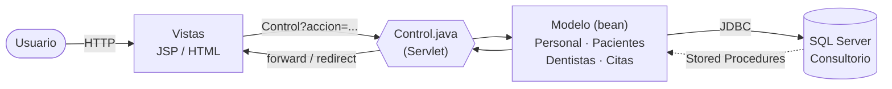
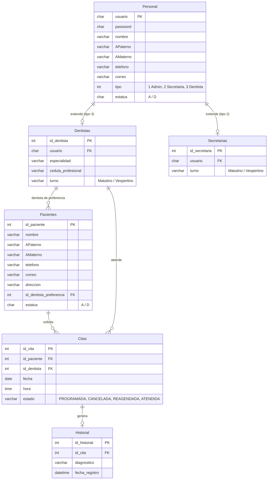

<div align="center">

# 🦷 Clínica Dental Vitalis

### Sistema de Gestión de Consultorio Dental

Aplicación web para administrar pacientes, personal, citas e historial clínico de un consultorio dental, con acceso diferenciado por rol.


</div>

---

## 📸 Vista previa

<table>
  <tr>
    <td align="center" width="50%">
      <br>
      <sub><b>Inicio de sesión</b> · acceso con usuario o correo</sub>
    </td>
    <td align="center" width="50%">
      <br>
      <sub><b>Captura de credenciales</b> · usuario <code>admin01</code></sub>
    </td>
  </tr>
</table>

<div align="center">
  <br>
  <sub><b>Dashboard del Administrador</b> · menú de Pacientes, Personal y Citas, con modo oscuro</sub>
</div>

---

## 📌 Tabla de contenidos

1. [Descripción](#-descripción)
2. [Estado del proyecto](#-estado-del-proyecto)
3. [Características principales](#-características-principales)
4. [Roles de usuario](#-roles-de-usuario)
5. [Reglas de negocio](#-reglas-de-negocio)
6. [Arquitectura](#-arquitectura)
7. [Estructura del proyecto](#-estructura-del-proyecto)
8. [Modelo de datos](#-modelo-de-datos)
9. [Procedimientos almacenados](#-procedimientos-almacenados)
10. [Tecnologías utilizadas](#-tecnologías-utilizadas)
11. [Instalación y configuración](#-instalación-y-configuración)
12. [Uso](#-uso)
13. [Pendientes y mejoras futuras](#-pendientes-y-mejoras-futuras)
14. [Equipo](#-equipo)

---

## 📖 Descripción

**Clínica Dental Vitalis** es un sistema web que digitaliza la operación diaria de un consultorio dental: el alta y mantenimiento de pacientes y personal, el agendamiento de citas sin choques de horario y el registro del diagnóstico de cada atención.

El proyecto sigue el patrón **MVC** con un servlet controlador central (`Control`), clases de modelo en Java (`bean`) que acceden a la base de datos por **JDBC**, vistas **JSP/HTML** y una base de datos **SQL Server** donde gran parte de la lógica de negocio vive en **procedimientos almacenados**.

---

## 🚦 Estado del proyecto

El proyecto está en desarrollo activo. Esta tabla refleja lo que funciona hoy y lo que sigue en construcción:

| Módulo | Estado | Detalle |
|---|:---:|---|
| Login con sesión y redirección por rol | ✅ | Valida contra `Personal` por usuario **o** correo, solo cuentas activas |
| Menús/dashboards por rol | ✅ | Administrador, Secretaria y Dentista, con navbar propio |
| Modo oscuro | ✅ | `js/modoOscuro.js` |
| Listado y edición de pacientes | ✅ | Acciones `pacientes`, `editar` y `actualizar` del controlador |
| Alta y baja de pacientes / personal | 🚧 | Vistas y procedimientos listos; falta conectarlos al controlador |
| Agendar, cancelar, reagendar y atender citas | 🚧 | Lógica completa en SQL; vistas JSP en prototipo |
| Historial clínico | 🚧 | `sp_FiltrarHistorial` listo; falta integrarlo a la interfaz |
| Reportes estadísticos (barras / pastel / PDF / Excel) | 🚧 | Procedimientos y librerías incluidos; en proceso |

✅ Funcional · 🚧 En desarrollo

---

## 🚀 Características principales

- **Control de acceso por roles:** tres perfiles (Administrador, Secretaria y Dentista), cada uno con su propio menú y vistas.
- **Asignación de dentista a pacientes nuevos:** si el paciente se registra sin médico de preferencia, el sistema le asigna uno activo al azar.
- **Respeto a la preferencia del paciente frecuente:** las citas se agendan con su dentista asignado.
- **Validación de disponibilidad:** no se permiten dos citas del mismo dentista en la misma fecha y hora.
- **Bajas lógicas:** ningún registro se borra; se marca con `estatus = 'D'` para conservar la integridad referencial.
- **Historial clínico:** el diagnóstico queda ligado a la cita atendida, con fecha y hora de registro.
- **Interfaz con modo oscuro** y diseño propio con CSS personalizado y Font Awesome.
- **Base para reportes:** consultas agregadas por semana, mes y año, listas para graficarse con JFreeChart.

---

## 👥 Roles de usuario

| Rol | `tipo` | Vista de entrada | Permisos |
|---|:---:|---|---|
| **Administrador** | `1` | `Admin/Menu1.jsp` | Gestión de pacientes y personal, seguimiento de citas y reportes |
| **Secretaria** | `2` | `Secretaria/Menu2.jsp` | Alta y edición de pacientes, agendar / reagendar / cancelar citas, consulta de disponibilidad e historial general |
| **Dentista** | `3` | `Dentista/Menu3.jsp` | Agenda propia por fecha, atención de citas y registro de diagnósticos |

> ⚠️ La redirección del login (`Personal.validar()`) y los datos semilla usan `2 = Secretaria` y `3 = Dentista`. Algunos comentarios y procedimientos del script SQL todavía describen el orden inverso; ver [Pendientes](#-pendientes-y-mejoras-futuras).

---

## ⚙️ Reglas de negocio

1. **Pacientes nuevos y frecuentes**
   - *Nuevo:* al registrarse sin `id_dentista_preferencia`, `sp_RegistrarPaciente` elige un dentista activo al azar con `ORDER BY NEWID()` y lo guarda como su preferencia.
   - *Frecuente:* si ya tiene dentista asignado, `sp_AgendarCita` lo usa por defecto (también acepta un dentista forzado).
2. **Disponibilidad de horarios**
   - No puede haber dos citas del mismo dentista en la misma fecha y hora, salvo que la anterior esté `CANCELADA`.
   - Al reagendar se revalida el nuevo horario excluyendo la propia cita.
3. **Ciclo de vida de una cita**

   ```mermaid
   stateDiagram-v2
       [*] --> PROGRAMADA: sp_AgendarCita
       PROGRAMADA --> REAGENDADA: sp_ReagendarCita
       REAGENDADA --> REAGENDADA: sp_ReagendarCita
       PROGRAMADA --> CANCELADA: sp_CancelarCita
       REAGENDADA --> CANCELADA: sp_CancelarCita
       PROGRAMADA --> ATENDIDA: sp_AtenderCita
       REAGENDADA --> ATENDIDA: sp_AtenderCita
       ATENDIDA --> [*]
       CANCELADA --> [*]
   ```

4. **Persistencia e integridad**
   - Personal y pacientes **nunca** se eliminan físicamente: la baja actualiza `estatus` a `'D'`.
   - Solo las cuentas con `estatus = 'A'` pueden iniciar sesión.

---

## 🏗️ Arquitectura

El sistema implementa **MVC** con un único servlet controlador que recibe el parámetro `accion` y decide a qué vista o modelo delegar.



**Acciones que atiende el controlador:**

| `accion` | Qué hace |
|---|---|
| `validar` | Autentica al usuario, guarda `tipo` y `nombreUsuario` en sesión y redirige al menú de su rol |
| `menu` | Regresa al menú principal según el rol en sesión |
| `pacientes` | Carga la lista de pacientes y la muestra en la vista del rol |
| `editar` | Carga un paciente y la lista de dentistas para editarlo |
| `actualizar` | Guarda los cambios del paciente y recarga la tabla |
| `logout` | Cierra la sesión y regresa al login |

---

## 📂 Estructura del proyecto

```text
CitasMedicas/
├── sql/
│   └── Consultorio.sql          # Tablas, datos semilla y stored procedures
├── src/java/
│   ├── Control.java             # Servlet controlador (MVC)
│   └── bean/                    # Modelo + acceso a datos (JDBC)
│       ├── conexion.java        #   Conexión a SQL Server
│       ├── Personal.java        #   Login y datos del personal
│       ├── Dentistas.java
│       ├── Secretarias.java
│       ├── Pacientes.java
│       ├── Citas.java
│       └── EncriptarMD5.java    #   Utilidad de hash MD5
├── web/
│   ├── index.html               # Login
│   ├── Admin/                   # Vistas del Administrador
│   ├── Secretaria/              # Vistas de la Secretaria
│   ├── Dentista/                # Vistas del Dentista
│   ├── css/  js/  fonts/  icons/  imgs/
│   └── WEB-INF/glassfish-web.xml
├── lib/                         # Dependencias .jar
├── img/                         # Capturas para este README
└── nbproject/                   # Configuración de NetBeans
```

---

## 🗄️ Modelo de datos

Base de datos: **`Consultorio`**.



| Tabla | Descripción |
|---|---|
| `Personal` | Tabla maestra de credenciales y datos personales de Administradores, Dentistas y Secretarias |
| `Dentistas` | Extensión del personal con especialidad, cédula profesional y turno |
| `Secretarias` | Extensión del personal con turno |
| `Pacientes` | Datos de contacto y dentista de preferencia (opcional) |
| `Citas` | Agenda: paciente, dentista, fecha, hora y estado |
| `Historial` | Diagnóstico ligado a una cita atendida, con marca de tiempo |

---

## 🛠️ Procedimientos almacenados

### Personal y usuarios
| Procedimiento | Función |
|---|---|
| `sp_RegistrarPersonal` | Alta genérica de Admin, Dentista o Secretaria |
| `sp_RegistrarDentista` | Alta de dentista con teléfono, correo, especialidad y cédula |
| `sp_RegistrarSecretaria` | Alta de secretaria con turno y teléfono |
| `sp_ActualizarPersonal` | Actualiza datos generales y especialidad |
| `sp_CambiarPasswordUsuario` | Cambio de contraseña (uso exclusivo del Administrador) |
| `sp_BajaUsuario` | Baja lógica de cualquier miembro del personal |
| `sp_ListarPersonal` | Lista todo el personal con sus datos específicos |
| `sp_ListarDentistasActivos` | Dentistas activos, útil para los selectores al agendar |

### Pacientes
| Procedimiento | Función |
|---|---|
| `sp_RegistrarPaciente` | Alta; si no hay preferencia, asigna un dentista activo al azar (`NEWID()`) |
| `sp_ActualizarPaciente` | Corrige datos de contacto y dentista de preferencia |
| `sp_BajaPacientecc` | Baja lógica del paciente |
| `sp_ListarPacientes` | Lista pacientes con el nombre de su dentista de preferencia |

### Citas y atención
| Procedimiento | Función |
|---|---|
| `sp_AgendarCita` | Resuelve el dentista (forzado o de preferencia), valida choque de horario y agenda |
| `sp_CancelarCita` | Cambia el estado a `CANCELADA` |
| `sp_ReagendarCita` | Cambia fecha y hora revalidando disponibilidad |
| `sp_VerCitasDentista` | Agenda de un dentista, filtrable por fecha |
| `sp_ListarCitasDelDia` | Citas de hoy; sin parámetro trae todas (Admin), con ID solo las del dentista |
| `sp_AtenderCita` | Guarda el diagnóstico en `Historial` y marca la cita como `ATENDIDA` |
| `sp_FiltrarHistorial` | Historial general, por dentista o por paciente según los parámetros que no sean `NULL` |

### Reportes y gráficas *(en proceso)*
| Procedimiento | Datos que entrega |
|---|---|
| `sp_DatosBarrasSemanal` / `sp_DatosPastelSemanal` | Citas por día y participación por dentista en un rango de fechas |
| `sp_DatosBarrasMensual` / `sp_DatosPastelMensual` | Citas por semana del mes y participación por dentista |
| `sp_DatosBarrasAnual` / `sp_DatosPastelAnual` | Citas por mes y participación por dentista en el año |

---

## 💻 Tecnologías utilizadas

| Capa | Tecnología |
|---|---|
| **Lenguaje** | Java 8 |
| **Backend web** | Servlets (anotación `@WebServlet`) y JSP, Java EE 8 |
| **Servidor de aplicaciones** | GlassFish 5.x |
| **Base de datos** | Microsoft SQL Server (T-SQL, stored procedures) |
| **Acceso a datos** | JDBC con `sqljdbc4` y `PreparedStatement` |
| **Patrón de diseño** | MVC con capa de modelo tipo DAO (`bean`) |
| **Frontend** | HTML5, CSS3 personalizado, JavaScript, Font Awesome |
| **Reportes** | iTextPDF 5.4.1 (PDF), JXL (Excel), JFreeChart 1.0.16 y JCommon (gráficas) |
| **IDE / Build** | Apache NetBeans (Ant) |
| **Control de versiones** | Git |

---

## 📋 Instalación y configuración

### Requisitos previos
- **JDK 8**
- **Apache NetBeans** (el proyecto usa su estructura de Ant)
- **GlassFish 5.x** (Java EE 8)
- **SQL Server** con **SSMS**, con autenticación SQL habilitada y TCP/IP activo en el puerto `1433`

### 1. Base de datos
1. Abre SQL Server Management Studio.
2. Ejecuta el script `sql/Consultorio.sql`. Crea la base `Consultorio`, las tablas, los datos semilla y los procedimientos almacenados.

### 2. Conexión JDBC
Edita las credenciales en `src/java/bean/conexion.java`:

```java
String USER = "sa";
String PASS = "tu_contraseña";
// URL usada:
// jdbc:sqlserver://localhost:1433;databaseName=Consultorio;encrypt=true;trustServerCertificate=true;
```

> Las dependencias `.jar` (incluido `sqljdbc4.jar`) ya están en la carpeta `lib/`.

### 3. Despliegue
1. Abre la carpeta del proyecto en **NetBeans** (`File ▸ Open Project`).
2. Verifica que el servidor asociado sea **GlassFish 5.x** y que las librerías de `lib/` aparezcan en el classpath.
3. Haz **Clean and Build** y luego **Run**. También puedes desplegar el `.war` generado en `dist/CitasMedicas.war`.
4. Abre en el navegador: `http://localhost:8081/CitasMedicas/` (ajusta el puerto al de tu servidor; por defecto GlassFish usa `8080`).

---

## 🧭 Uso

1. Entra a la pantalla de login e ingresa **usuario o correo** y contraseña.
2. El sistema te redirige al menú de tu rol.
3. Los usuarios y contraseñas de prueba se encuentran en la sección de inserciones previas de `Consultorio.sql`:

| Usuario | Rol |
|---|---|
| `admin01`, `admin02`, `admin03` | Administrador |
| `sec01`, `sec02` | Secretaria |
| `dentista01`, `dentista02` | Dentista |

---

## 🔭 Pendientes y mejoras futuras

- [ ] Conectar al controlador el alta y baja de pacientes y personal.
- [ ] Integrar en la interfaz el agendado, cancelación, reagendado y atención de citas.
- [ ] Construir la vista de historial clínico y el módulo de reportes (PDF, Excel y gráficas).
- [ ] Almacenar contraseñas con hash (la utilidad `EncriptarMD5` existe pero el login aún compara texto plano); idealmente migrar a un algoritmo más robusto como bcrypt.
- [ ] Mover las credenciales de la base de datos fuera del código fuente (variables de entorno o `DataSource` del servidor).
- [ ] Unificar la convención de roles (`2`/`3`) entre el login, los datos semilla y los procedimientos `sp_RegistrarPersonal` / `sp_ActualizarPersonal`.
- [ ] Completar los campos obligatorios (`turno`, `cedula_profesional`) en los procedimientos de alta de dentistas.
- [ ] Agregar validación de sesión y rol en las vistas para impedir el acceso directo por URL.

---

## 👨‍💻 Equipo

| Integrante |
|---|
| Eduardo Flores Velázquez |
| Oswaldo Yael Alonso Guarneros |
| Paul Isaac Mendoza López |

---

<div align="center">
<sub>Proyecto académico · Clínica Dental Vitalis · Sistema de Gestión de Consultorio Dental</sub>
</div>
