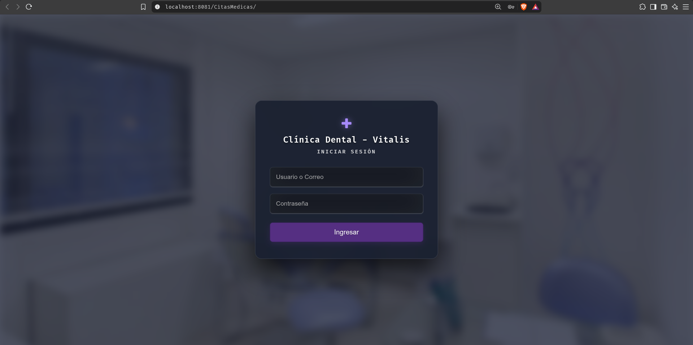
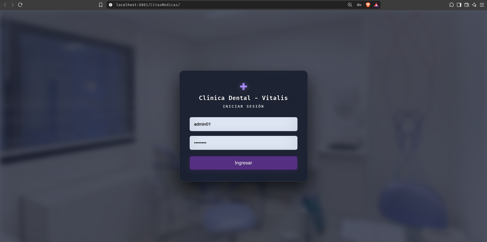
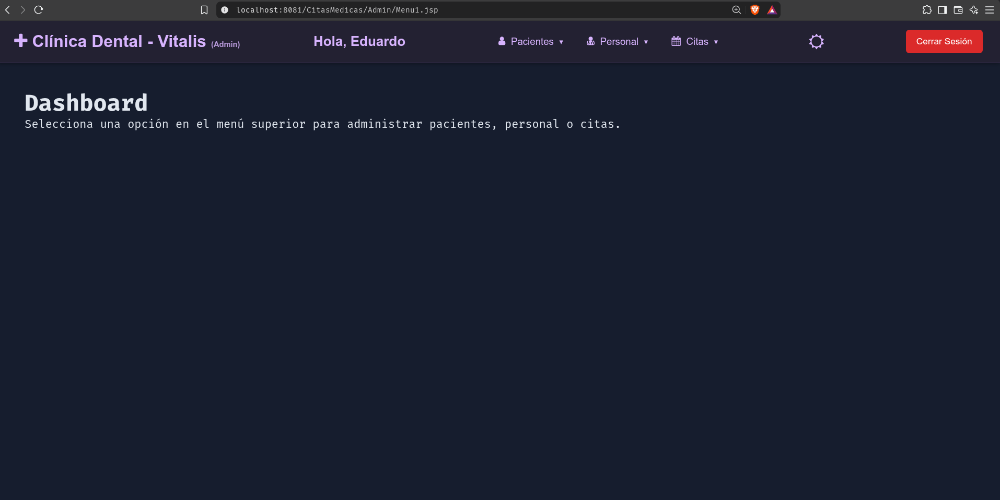
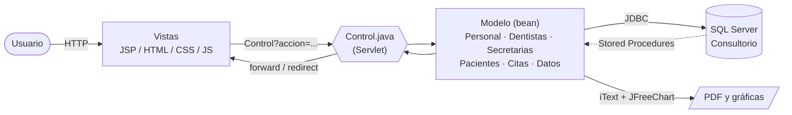
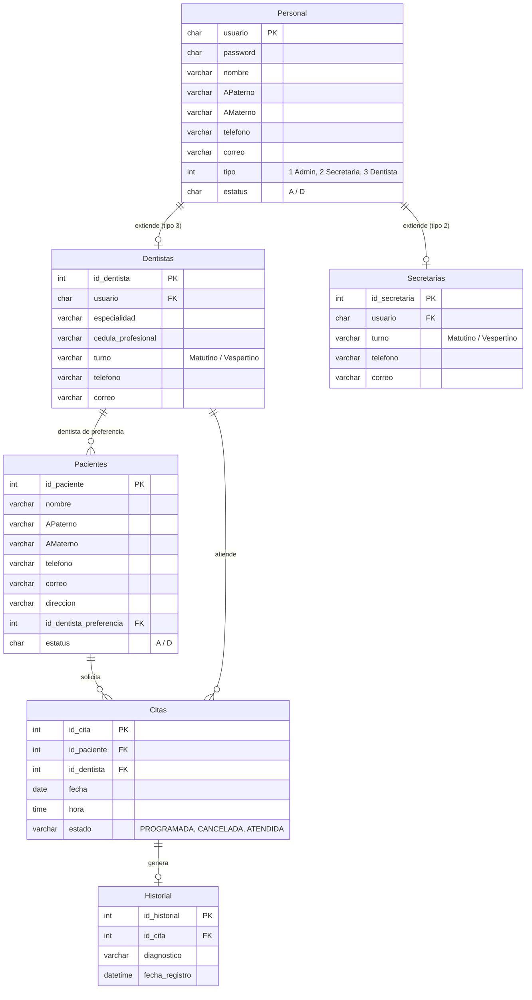

<div align="center">

# 🦷 Clínica Dental Vitalis

### Sistema de Gestión de Consultorio Dental

Aplicación web para administrar pacientes, personal, citas, historial clínico y reportes de un consultorio dental, con acceso diferenciado por rol.


</div>

---

## 📸 Vista previa

<table>
  <tr>
    <td align="center" width="50%">
      <br>
      <sub><b>Inicio de sesión</b></sub>
    </td>
    <td align="center" width="50%">
      <br>
      <sub><b>Captura de credenciales</b></sub>
    </td>
  </tr>
</table>

<div align="center">
  <br>
  <sub><b>Dashboard del Administrador</b> · modo oscuro</sub>
</div>

<!--
  ➕ CAPTURAS PENDIENTES: guarda las imágenes en /img con estos nombres
  y descomenta el bloque (quita las marcas de comentario).

<table>
  <tr>
    <td align="center"><br><sub><b>Dashboard Secretaria</b></sub></td>
    <td align="center"><br><sub><b>Dashboard Dentista</b></sub></td>
  </tr>
  <tr>
    <td align="center"><br><sub><b>Gestión de pacientes</b></sub></td>
    <td align="center"><br><sub><b>Gestión de personal</b></sub></td>
  </tr>
  <tr>
    <td align="center"><br><sub><b>Agenda de citas</b></sub></td>
    <td align="center"><br><sub><b>Atención de cita / diagnóstico</b></sub></td>
  </tr>
  <tr>
    <td align="center"><br><sub><b>Gráficas de barras y pastel</b></sub></td>
    <td align="center"><br><sub><b>Reporte en PDF</b></sub></td>
  </tr>
</table>
-->

---

## 📌 Tabla de contenidos

1. [Descripción](#-descripción)
2. [Funcionalidades](#-funcionalidades)
3. [Roles de usuario](#-roles-de-usuario)
4. [Reglas de negocio](#-reglas-de-negocio)
5. [Arquitectura](#-arquitectura)
6. [Estructura del proyecto](#-estructura-del-proyecto)
7. [Modelo de datos](#-modelo-de-datos)
8. [Procedimientos almacenados](#-procedimientos-almacenados)
9. [Reportes y gráficas](#-reportes-y-gráficas)
10. [Tecnologías utilizadas](#-tecnologías-utilizadas)
11. [Instalación y configuración](#-instalación-y-configuración)
12. [Uso](#-uso)
13. [Mejoras futuras](#-mejoras-futuras)
14. [Equipo](#-equipo)

---

## 📖 Descripción

**Clínica Dental Vitalis** digitaliza la operación diaria de un consultorio dental: alta y mantenimiento de pacientes y personal, agendamiento de citas sin choques de horario y por turno, registro del diagnóstico de cada atención y generación de reportes estadísticos en PDF.

Está construido con el patrón **MVC**: un servlet controlador central (`Control`), clases de modelo en Java (`bean`) que acceden a datos por **JDBC**, vistas **JSP** y una base de datos **SQL Server** donde gran parte de la lógica de negocio vive en **procedimientos almacenados**.

---

## 🚀 Funcionalidades

| Módulo | Qué incluye |
|---|---|
| 🔐 **Autenticación** | Login con sesión, solo cuentas activas, redirección automática al menú del rol |
| 🏠 **Dashboard** | Tabla de **citas del día** según el rol (todas para el Administrador, solo las propias para el Dentista) |
| 🧑‍🤝‍🧑 **Pacientes** | Alta, edición, baja lógica y listado con filtros. El Dentista ve únicamente a sus pacientes |
| 👩‍⚕️ **Personal** *(Administrador)* | Alta de Administradores, Dentistas y Secretarias; edición; baja lógica; regeneración y cambio de contraseña |
| 📅 **Citas** | Agendar, reagendar, cancelar y atender (diagnóstico), con vistas de pendientes e historial y filtros por fecha, doctor y paciente |
| 🩺 **Historial clínico** | Diagnóstico ligado a cada cita atendida; exportación del historial a **PDF** |
| 📊 **Gráficas** *(Administrador y Secretaria)* | Gráficas de barras y pastel por doctor y periodo (semanal, mensual, anual) con exportación a **PDF** |
| 🌙 **Interfaz** | Modo oscuro, ventanas modales y animaciones de carga |

---

## 👥 Roles de usuario

| Rol | `tipo` | Vista de entrada | Permisos |
|---|:---:|---|---|
| **Administrador** | `1` | `Admin/Menu1.jsp` | Pacientes, personal, citas y gráficas |
| **Secretaria** | `2` | `Secretaria/Menu2.jsp` | Pacientes, citas (agendar / reagendar / cancelar) e historial y gráficas |
| **Dentista** | `3` | `Dentista/Menu3.jsp` | Sus pacientes y su agenda; atención de citas con registro de diagnóstico |

---

## ⚙️ Reglas de negocio

1. **Pacientes nuevos y frecuentes**
   - Si el paciente se registra **sin** médico de preferencia, `sp_RegistrarPaciente` le asigna un dentista activo **al azar** (`ORDER BY NEWID()`) y lo guarda como su preferencia.
   - Si se indica un médico, se valida que exista y esté activo.
2. **Horario de atención por turno**
   - Turno **Matutino:** 08:00 a 14:00 · Turno **Vespertino:** 15:00 a 20:00.
   - Una cita solo puede agendarse dentro del turno del dentista.
3. **Asignación al agendar** (`sp_AgendarCita`)
   - Con dentista elegido: se valida su turno y que esté libre en esa fecha y hora.
   - Sin dentista elegido: se usa el **médico de preferencia** del paciente si cubre el turno y está libre; si no, se asigna el primer dentista disponible en ese turno.
   - No existen dos citas `PROGRAMADA` del mismo dentista en la misma fecha y hora.
4. **Ciclo de vida de una cita**

   ```mermaid
   stateDiagram-v2
       [*] --> PROGRAMADA: sp_AgendarCita
       PROGRAMADA --> PROGRAMADA: sp_ReagendarCita
       PROGRAMADA --> CANCELADA: sp_CancelarCita
       PROGRAMADA --> ATENDIDA: sp_AtenderCita
       CANCELADA --> [*]
       ATENDIDA --> [*]
   ```

   Solo se pueden cancelar o reagendar citas en estado `PROGRAMADA`.
5. **Alta de personal**
   - El usuario se genera automáticamente (3 letras del nombre, del apellido paterno y del materno + 3 dígitos) y se asigna una contraseña inicial que el Administrador puede regenerar o cambiar.
   - Dentistas requieren especialidad, cédula profesional y turno; las secretarias requieren turno.
6. **Persistencia e integridad**
   - Personal y pacientes **no se eliminan**: la baja es lógica (`estatus = 'D'`).
   - Solo las cuentas con `estatus = 'A'` pueden iniciar sesión.
   - Los procedimientos de personal y pacientes usan **transacciones** con `TRY/CATCH` y devuelven un mensaje al sistema mediante parámetros `OUTPUT`.

---

## 🏗️ Arquitectura



**Acciones del controlador (`Control?accion=`):**

| Módulo | Acciones |
|---|---|
| Sesión | `validar`, `menu`, `logout` |
| Pacientes | `pacientes`, `registrar`, `editar`, `actualizar`, `eliminar` |
| Personal | `personal`, `registrarPersonal`, `editarPersonal`, `actualizarPersonal`, `eliminarPersonal`, `regenerarPassword`, `cambiarPassword` |
| Citas | `citas`, `agendar`, `reagendar`, `cancelar`, `atender`, `pdfCitas` |
| Reportes | `graficas`, `pdfGraficas` |

---

## 📂 Estructura del proyecto

```text
CitasMedicas/
├── sql/
│   ├── Consultorio.sql               # Base de datos, tablas y stored procedures
│   ├── datos_consultorio_prueba.sql  # Datos de prueba (personal, pacientes, citas, historial)
│   └── reorder-data.sql              # Utilidad para renumerar IDs
├── src/java/
│   ├── Control.java                  # Servlet controlador (MVC)
│   └── bean/                         # Modelo y acceso a datos (JDBC)
│       ├── conexion.java             #   Conexión a SQL Server
│       ├── Personal.java             #   Login y gestión de personal
│       ├── Dentistas.java
│       ├── Secretarias.java
│       ├── Pacientes.java
│       ├── Citas.java                #   Agenda, historial y PDF de citas
│       ├── Datos.java                #   Gráficas (JFreeChart) y PDF de reportes
│       └── EncriptarMD5.java
├── web/
│   ├── index.html                    # Login
│   ├── Error.jsp
│   ├── Admin/                        # Menu1, Pacientes, Personal, Citas, graficas
│   ├── Secretaria/                   # Menu2, Pacientes, Citas, graficas
│   ├── Dentista/                     # Menu3, Pacientes, Citas
│   ├── css/  js/  fonts/  icons/  imgs/
│   └── WEB-INF/glassfish-web.xml
├── lib/                              # Dependencias .jar
└── img/                              # Capturas para este README
```

---

## 🗄️ Modelo de datos

Base de datos: **`Consultorio`**.



| Tabla | Descripción |
|---|---|
| `Personal` | Tabla maestra de credenciales y datos de Administradores, Dentistas y Secretarias |
| `Dentistas` | Extensión del personal: especialidad, cédula profesional y turno |
| `Secretarias` | Extensión del personal: turno |
| `Pacientes` | Datos de contacto y dentista de preferencia (opcional) |
| `Citas` | Agenda: paciente, dentista, fecha, hora y estado |
| `Historial` | Diagnóstico ligado a una cita atendida, con marca de tiempo |

---

## 🛠️ Procedimientos almacenados

| Módulo | Procedimiento | Función |
|---|---|---|
| **Personal** | `sp_RegistrarPersonal` | Alta de Admin, Dentista o Secretaria (transaccional, valida campos y duplicados) |
| | `sp_ActualizarPersonal` | Actualiza datos generales y los específicos del rol |
| | `sp_CambiarPasswordUsuario` | Cambia la contraseña de un usuario |
| | `sp_BajaUsuario` | Baja lógica del personal |
| **Pacientes** | `sp_RegistrarPaciente` | Alta; asigna dentista al azar si no hay preferencia |
| | `sp_ActualizarPaciente` | Edita datos y dentista de preferencia |
| | `sp_BajaPaciente` | Baja lógica del paciente |
| **Citas** | `sp_AgendarCita` | Valida turno y disponibilidad, resuelve el dentista y agenda |
| | `sp_CancelarCita` | Cancela una cita programada |
| | `sp_ReagendarCita` | Cambia fecha y hora revalidando turno y disponibilidad |
| | `sp_AtenderCita` | Guarda el diagnóstico en `Historial` y marca la cita `ATENDIDA` |
| | `sp_FiltrarHistorial` | Citas filtradas por dentista, paciente y fecha; modo pendientes o historial |
| | `sp_ListarCitasDelDia` | Citas programadas de hoy (todas, o las de un dentista) |

---

## 📊 Reportes y gráficas

Disponible para **Administrador** y **Secretaria**.

1. Selecciona un **doctor** (o todos) y un **periodo**: semanal (últimos 7 días), mensual (último mes) o anual (último año).
2. Pulsa **Crear Gráficas** para generar una gráfica de **barras** y una de **pastel** con los pacientes por estado de cita (`JFreeChart`).
3. Exporta el resultado a **PDF** (`iText`).

Adicionalmente, el historial de citas se exporta a PDF (`Historial_Citas.pdf`) respetando los filtros y el rol del usuario.

---

## 💻 Tecnologías utilizadas

| Capa | Tecnología |
|---|---|
| **Lenguaje** | Java 8 |
| **Backend web** | Servlets (`@WebServlet`) y JSP, Java EE 8 |
| **Servidor de aplicaciones** | GlassFish 5.x |
| **Base de datos** | Microsoft SQL Server (T-SQL, stored procedures, transacciones) |
| **Acceso a datos** | JDBC con `sqljdbc4`, `PreparedStatement` y `CallableStatement` |
| **Patrón de diseño** | MVC con capa de modelo tipo DAO (`bean`) |
| **Frontend** | HTML5, CSS3 personalizado, JavaScript, Font Awesome |
| **Reportes** | iTextPDF 5.4.1 (PDF), JFreeChart 1.0.16 y JCommon (gráficas) |
| **IDE / Build** | Apache NetBeans (Ant) |
| **Control de versiones** | Git |

---

## 📋 Instalación y configuración

### Requisitos
- **JDK 8**
- **Apache NetBeans**
- **GlassFish 5.x** (Java EE 8)
- **SQL Server** + **SSMS**, con autenticación SQL y TCP/IP habilitados en el puerto `1433`

### 1. Base de datos
En SSMS, ejecuta en este orden:

1. `sql/Consultorio.sql`: crea la base `Consultorio`, las tablas y los procedimientos.
2. `sql/datos_consultorio_prueba.sql`: carga personal, pacientes, citas e historial de ejemplo.

### 2. Conexión JDBC
Edita las credenciales en `src/java/bean/conexion.java`:

```java
String USER = "sa";
String PASS = "tu_contraseña";
// jdbc:sqlserver://localhost:1433;databaseName=Consultorio;encrypt=true;trustServerCertificate=true;
```

### 3. Despliegue
1. Abre el proyecto en **NetBeans** (`File ▸ Open Project`) y asocia el servidor **GlassFish 5.x**.
2. Verifica que las librerías de `lib/` estén en el classpath.
3. **Clean and Build** y luego **Run** (o despliega `dist/CitasMedicas.war`).
4. Abre `http://localhost:8081/CitasMedicas/` (ajusta el puerto al de tu servidor; GlassFish usa `8080` por defecto).

---

## 🧭 Uso

1. Ingresa tu **usuario** y **contraseña** en la pantalla de login.
2. Serás redirigido al menú de tu rol.
3. Cuentas de prueba (las contraseñas están en `datos_consultorio_prueba.sql`):

| Usuario | Rol |
|---|---|
| `admin01`, `admin02`, `admin03` | Administrador |
| `sec01`, `sec02` | Secretaria |
| `dentista01` a `dentista04` | Dentista |

---

## 🔭 Mejoras futuras

- [ ] Almacenar contraseñas con hash robusto (bcrypt) y comparar el hash en el login.
- [ ] Mover las credenciales de la base de datos fuera del código (variables de entorno o `DataSource` del servidor).
- [ ] Validar sesión y rol en todas las vistas JSP para impedir el acceso directo por URL.
- [ ] Exportación de reportes a Excel.
- [ ] Notificaciones o recordatorios de citas por correo o SMS.
- [ ] Búsqueda de disponibilidad en calendario visual.

---

## 👨‍💻 Equipo

| Integrante |
|---|
| Eduardo Flores Velázquez |
| Oswaldo Yael Alonso Guarneros |
| Paul Isaac Mendoza López |

---

<div align="center">
<sub>Proyecto académico · Clínica Dental Vitalis · Sistema de Gestión de Consultorio Dental</sub>
</div>
